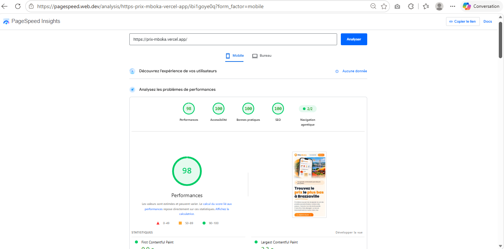

# Prix Mboka

Application web qui permet de signaler et de comparer les prix des produits courants (manioc, tomate, huile de palme, poisson salé, riz) dans les marchés de Brazzaville : Total, Poto-Poto, Moungali, Ouenzé et Talangaï.

**Production : https://prix-mboka.vercel.app**

Projet de groupe du livrable S22 (Akieni Academy), groupe 9.

## Compte de test

- Email : `test@prixmboka.cg`
- Mot de passe : `Test1234!`

Il est aussi possible de créer un compte sur `/inscription`.

## Équipe (groupe 9) et comptes Git

| Membre | Compte Git | Contribution |
|---|---|---|
| MOUSSANA Dorcasse Benicia | @Benicia264 | Auth, déploiement, features, rendu et performance |
| OWALA Brichelvie Jeannelle | @valorjeannelle | Page `/prix` (première version) |
| PAMBOU Prince Isaac | [@compte-à-compléter] | Pas de contribution cette semaine |
| MOUSSOUNDA Karène | [@compte-à-compléter] | Pas de contribution cette semaine |
| KEDO Tony Bérenger | [@compte-à-compléter] | Pas de contribution cette semaine |

### Répartition des rôles S22

| Rôle | Responsable | Preuve |
|---|---|---|
| Auth | @Benicia264 | Pull request « auth » fusionnée |
| Rendu et performance | @Benicia264 (SSG, ISR, SSR, audit Lighthouse) avec @valorjeannelle (page `/prix`) | Section « Rendu » et capture Lighthouse ci-dessous |
| Déploiement | @Benicia264 | URL de production et checklist ci-dessous |
| Features | @Benicia264 et @valorjeannelle | Issues fermées et pull requests fusionnées |

Cette semaine, trois membres du groupe n'ont pas pu contribuer. OWALA Brichelvie Jeannelle, seule autre membre à s'être manifestée, a participé sans machine : elle a écrit la première version de la page `/prix`. Le reste du développement a été porté par @Benicia264.

## Fonctionnalités

- Page d'accueil, navigation et style commun
- Inscription, connexion et déconnexion (Auth.js)
- Signaler un prix : produit, marché, prix, commentaire facultatif
- Liste des prix avec filtre par marché
- Mes signalements, avec suppression confirmée
- Pages d'information : marchés, comment ça marche

## Technologies

Next.js (App Router), Auth.js, Prisma, PostgreSQL (Neon), Tailwind CSS, déploiement sur Vercel.

## Lancer le projet en local

```bash
npm install
npx prisma migrate deploy
npx prisma db seed
npm run dev
```

Créer un fichier `.env` à la racine (voir `.env.example`, aucun secret n'est dans le dépôt) :

- `DATABASE_URL` : adresse de la base PostgreSQL
- `AUTH_SECRET` : secret d'Auth.js

Le script `seed` crée les marchés, les produits et le compte de test.

## Authentification

Auth.js avec connexion par email et mot de passe (mots de passe chiffrés avec bcrypt) et session JWT persistante. Le middleware (`proxy.ts`, nom utilisé par Next.js 16) protège `/signaler` et `/mes-signalements` : un visiteur non connecté est renvoyé vers `/connexion`. Après la connexion, l'utilisateur arrive sur `/prix`.

## Rendu

| Page | Stratégie | Justification |
|---|---|---|
| `/marches` | SSG | Liste des marchés identique pour tous, qui change rarement : elle est générée une seule fois à la construction, donc très rapide. |
| `/comment-ca-marche` | SSG | Contenu rédactionnel fixe, sans donnée de la base. |
| `/prix` | ISR (`revalidate = 60`) | Les prix changent souvent mais n'ont pas besoin d'être en temps réel. La page est servie comme une page statique et régénérée en arrière-plan au plus une fois par minute, ce qui évite une requête à la base à chaque visite. Le filtre par marché se fait côté navigateur. |
| `/mes-signalements` | SSR | Contenu propre à chaque utilisateur : la session et la base sont lues à chaque requête. |
| `/signaler` | SSR | Page protégée dont les listes (produits, marchés) viennent de la base à chaque affichage. |

Les menus sont statiques : l'état de connexion (initiales ou boutons) est chargé côté navigateur après l'affichage de la page, ce qui permet de garder les pages publiques en SSG et en ISR.

Vérification : dans la sortie de `npm run build`, `/marches`, `/comment-ca-marche` et `/prix` sont marquées statiques (`○`), `/prix` avec une revalidation d'une minute, tandis que `/mes-signalements` et `/signaler` sont dynamiques (`ƒ`).

## Performance

Audit PageSpeed Insights (Lighthouse), mobile, sur l'URL de production :

- **Performance : 98**
- **Accessibility : 100**



## Checklist de déploiement (Vercel)

1. Importer le dépôt GitHub dans Vercel (plan Hobby).
2. Ajouter les variables d'environnement `DATABASE_URL` et `AUTH_SECRET` (Settings, Environment Variables).
3. Vérifier que `package.json` contient `"postinstall": "prisma generate"`.
4. Déployer, puis redéployer après l'ajout des variables.
5. Tester `/connexion` avec le compte de test sur l'URL de production.

## Backlog

Les fonctionnalités sont suivies dans les issues GitHub et dans le tableau « Backlog S22 » (statut et assignation).

## Bug bash

Issues ouvertes sur le dépôt d'un autre groupe : [liens à ajouter après le vendredi].